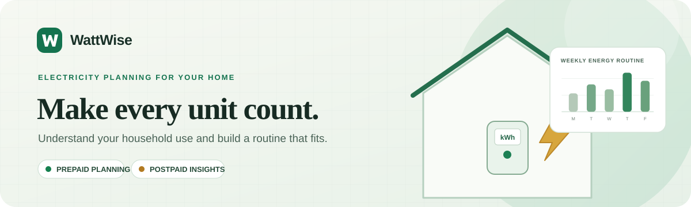
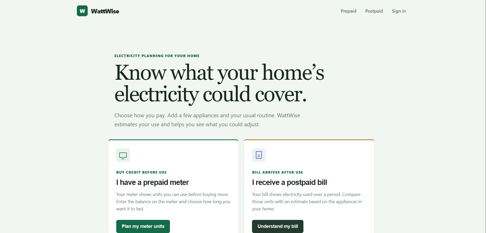
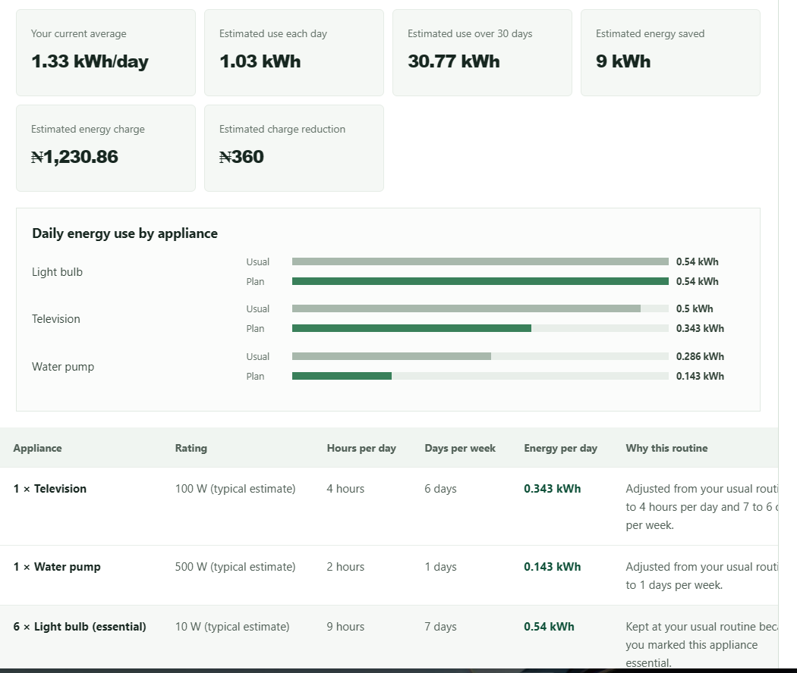
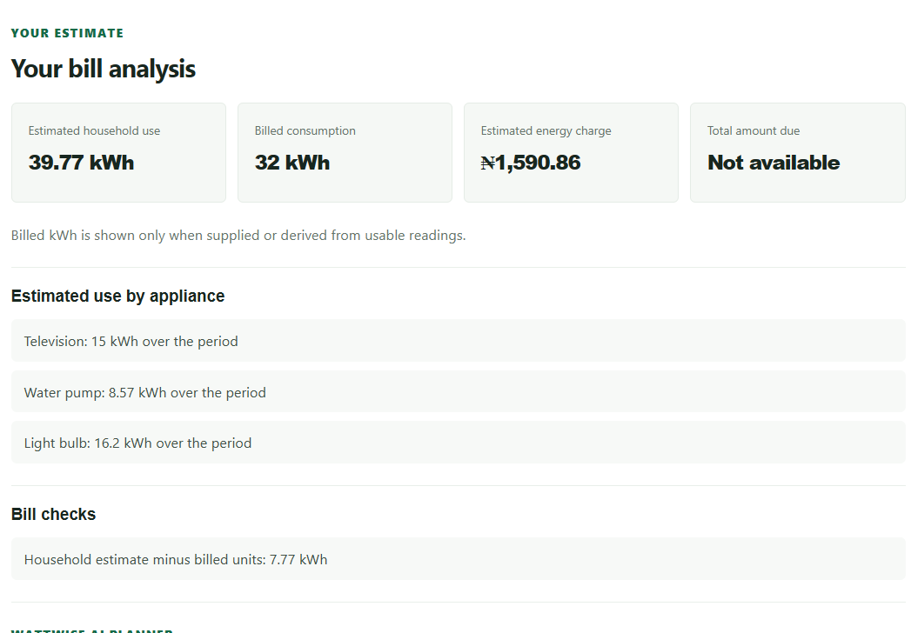
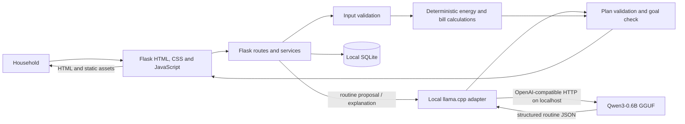

# WattWise

<p align="center">
  
</p>

WattWise is a local-first electricity planning web app for Nigerian households. It helps prepaid customers plan how to make their current meter units last, and helps postpaid customers understand household appliance use alongside the figures on their electricity bill.

The app combines deterministic Python calculations with a locally run Qwen model. The model proposes appliance routines; WattWise calculates the energy use and checks whether a proposed routine reaches the household's goal.

> **Project status:** Student hackathon MVP. It is not connected to a Distribution Company (DisCo), electricity meter, vending service, or payment provider. It does not read bills from images or detect billing fraud.

## Contents

- [What it does](#what-it-does)
- [Screenshots](#screenshots)
- [How it works](#how-it-works)
- [Technology](#technology)
- [Run locally](#run-locally)
- [Use the app](#use-the-app)
- [Test](#test)
- [Repository layout](#repository-layout)
- [Documentation](#documentation)
- [Privacy and data](#privacy-and-data)
- [Model, dependencies, and licensing](#model-dependencies-and-licensing)
- [Acknowledgements](ACKNOWLEDGEMENTS.md)
- [Known limitations](#known-limitations)

## What it does

### Prepaid households

Enter the units currently remaining on the meter, how long they should last, and the household appliances and usual routines. WattWise estimates daily use, checks whether the goal fits the available units, and can ask Qwen to suggest a routine. A recent top-up receipt is optional context; units on a receipt are not treated as the current meter balance.

### Postpaid households

Enter appliances and routines, the bill period, and any bill details available (such as billed kWh, meter readings, tariff, energy charge, and amount due). WattWise estimates household consumption and compares it with supplied or reading-derived consumption. The AI planner can suggest a routine toward a user-selected reduction in estimated household energy use.

### AI routine planner

For either service type, Qwen proposes a structured appliance schedule. The interface presents the verified result as a goal summary, energy and cost estimates where possible, an appliance comparison chart, and an editable schedule table. WattWise protects appliances the user marked as essential and recalculates the plan in Python. If a goal is not feasible without changing essential use, the app reports the closest safe plan instead of claiming success.

## Screenshots

These captures show the current WattWise interface with example analysis values. They are not official DisCo readings or tariff quotations.

<p align="center">
  
</p>
<p align="center"><em>Choose the service that matches the household: prepaid meter units or a postpaid bill.</em></p>

<p align="center">
  
</p>
<p align="center"><em>Review the suggested routine, see the estimated energy change, and inspect appliance-by-appliance assumptions.</em></p>

<p align="center">
  
</p>
<p align="center"><em>Compare estimated household use with bill details supplied by the user.</em></p>

## How it works



**Text version:** Household → Flask web interface → authenticated Flask routes and services → validated input → Python energy/bill calculations. For AI plans, the routes call the local `llama.cpp` adapter, which requests structured routine JSON from Qwen; WattWise validates the proposed plan and calculates its results before returning it to the interface. Account and saved analysis data are stored in local SQLite. The calculations continue to work when the model server is unavailable.

Core prepaid and postpaid calculations work without Qwen. AI routine generation and AI-written explanations require the separate local model server. The model does not supply authoritative kWh, duration, bill comparisons, or charges.

## Technology

- Python 3.10 or newer and Flask
- Server-rendered HTML, CSS, and browser JavaScript
- SQLite for local accounts, household preferences, saved appliance profiles, and analysis history
- Email/password accounts with scrypt password hashes and short-lived JWT session cookies
- Qwen3-0.6B GGUF served locally by `llama.cpp`
- Python validation and deterministic energy calculations, independent of model inference

## Run locally

### Prerequisites

- Git
- Python 3.10+
- Node.js, only for the JavaScript syntax checks
- `llama.cpp` with the `llama` command available, for AI planning and explanations
- Internet access on the first model start to download the Q8_0 GGUF file from Hugging Face (about 639 MB). The model is cached locally; later starts can use the cache.

The app and model server bind to `127.0.0.1` by default. They are intended for a single-computer demo/development setup, not exposure to a public network.

### 1. Get the project and install Python dependencies

Run these commands from the repository root.

**Windows PowerShell:**

```powershell
git clone https://github.com/adesinaisaiah100/wattwise.git
cd wattwise
py -3 -m venv .venv
.\.venv\Scripts\Activate.ps1
python -m pip install --upgrade pip
pip install -r requirements.txt
```

If PowerShell blocks local virtual-environment activation, allow it for the current terminal only and activate again:

```powershell
Set-ExecutionPolicy -Scope Process -ExecutionPolicy Bypass
.\.venv\Scripts\Activate.ps1
```

**macOS / Linux (bash or zsh):**

```bash
git clone https://github.com/adesinaisaiah100/wattwise.git
cd wattwise
python3 -m venv .venv
source .venv/bin/activate
python -m pip install --upgrade pip
pip install -r requirements.txt
```

If the project is provided as a ZIP, extract it and `cd` into the extracted `wattwise` folder instead.

### 2. Install and start the local model server (needed for AI features)

Install `llama.cpp` using its official installation instructions. On Windows, WinGet is supported; on macOS and Linux, use the installer or platform package described by the project:

```powershell
winget install llama.cpp
```

```bash
curl -LsSf https://llama.app/install.sh | sh
```

Open a **new terminal** after installing if the `llama` command is not found. Then start WattWise's selected model and keep this terminal open.

**Windows PowerShell** (the included helper also checks the standard WinGet package location):

```powershell
.\scripts\start_model.ps1
```

**macOS / Linux:**

```bash
sh scripts/start_model.sh
```

Or run the model command directly on any platform:

```text
llama serve -hf Qwen/Qwen3-0.6B-GGUF:Q8_0 --host 127.0.0.1 --port 8080
```

The first run downloads the model. Confirm the server is ready at `http://127.0.0.1:8080/health` (it should return an `ok` status). If the command is unavailable, install `llama.cpp` or add its executable directory to `PATH`; the older `llama-cli` binary is a command-line runner and does not start the API server WattWise needs.

### 3. Start WattWise and open the web app

In another terminal, from the repository root, activate `.venv` if needed and run:

```powershell
python app.py
```

The same command works in macOS/Linux after activating the virtual environment. Open [http://127.0.0.1:5000](http://127.0.0.1:5000), register an account, and select prepaid or postpaid during onboarding. Flask serves both the HTML pages and their CSS/JavaScript assets; no separate frontend build or Gradio process is used.

Check app and model status at [http://127.0.0.1:5000/api/health](http://127.0.0.1:5000/api/health). The app starts without Qwen, but AI planning and explanations will be unavailable until the model server is running.

### Configuration

Defaults are configured in `app.py`. `.env.example` documents available variable names but is **not automatically loaded**; set variables in the shell before starting Flask. For example, in PowerShell:

```powershell
$env:LLAMA_BASE_URL = "http://127.0.0.1:8080/v1"
$env:LLAMA_MODEL = "Qwen/Qwen3-0.6B-GGUF:Q8_0"
$env:LLAMA_TIMEOUT_SECONDS = "120"
python app.py
```

In bash/zsh, use `export LLAMA_TIMEOUT_SECONDS=120` before `python app.py`. The longer timeout can help on slower computers. See `.env.example` for database path, signing key, cookie, host, and port settings. For a public deployment, use HTTPS, a secure secret, and a production WSGI server; the built-in Flask server is for local development only.

## Use the app

1. Register or sign in, then choose **Prepaid** or **Postpaid**. An account is set to one service type at a time.
2. Add household appliances, quantities, their watt rating (or measured daily energy), and a realistic weekly routine. Typical catalog values are estimates; a rating from the appliance label improves the estimate.
3. Enter the service-specific details. Prepaid uses the units currently on the meter and a target duration. Postpaid accepts partial bill details and keeps amount due separate from energy charge.
4. Review WattWise's estimate and assumptions. Generate an AI routine plan if you want a goal-based schedule, inspect its chart/table, then apply and recalculate it if it suits the household.
5. Save an appliance setup or analysis history explicitly while signed in. These records stay in the local SQLite database.

See [the synthetic demo walkthrough](docs/DEMO.md) for a repeatable prepaid and postpaid presentation flow.

## Test

Activate `.venv` from the project root. Run the automated unit/API suite:

```powershell
python -m unittest discover -s tests -v
```

Check frontend syntax and Python compilation:

```powershell
node --check static/js/app.js
node --check static/js/auth.js
node --check static/js/account.js
node --check static/js/session.js
node --check static/js/onboarding.js
python -m compileall -q app.py ai api auth core services storage tests
```

For an end-to-end HTTP smoke test, start Flask in one terminal and run in another:

```powershell
powershell.exe -NoProfile -ExecutionPolicy Bypass -File .\scripts\test-platform.ps1
```

This creates synthetic accounts and analysis records in the database configured for the running app and prints a test password. Keep those credentials private. To include live model-generated routines for both payment modes and a streamed explanation, start Qwen first and run:

```powershell
powershell.exe -NoProfile -ExecutionPolicy Bypass -File .\scripts\test-platform.ps1 -TestModel
```

The Python automated suite uses temporary SQLite databases. The PowerShell smoke script uses the database belonging to the running server.

## Repository layout

```text
app.py                    Flask app factory, configuration, and browser page routes
ai/                       Local llama.cpp adapter and Qwen prompts/response parsing
api/                      Analysis, AI, account, authentication, and health endpoints
auth/                     Password hashing, JWT sessions, and request protections
core/                     Validated inputs and framework-independent calculations
services/                 Request-to-analysis and verified plan orchestration
storage/                  SQLite schema and local persistence
templates/                Flask/Jinja pages and shared appliance editor
static/css/                Responsive page and household planning styles
static/js/                 Browser forms, streamed AI UI, auth, onboarding, account
scripts/                  Model startup and full-platform smoke-test helpers
tests/                    Automated calculation, adapter, auth, API, and persistence tests
docs/                     API notes and reproducible synthetic demo guide
phases/                   Phase plans, API contracts, and synthetic request/result fixtures
SYSTEM_DESIGN.md          Domain rules, flows, component design, and data model
```

## Documentation

- [System design](SYSTEM_DESIGN.md) — domain rules, module responsibilities, data model, and request flows.
- [API reference](docs/API.md) — routes, inputs, auth requirements, and plan response semantics.
- [Demo walkthrough](docs/DEMO.md) — synthetic cases and presentation checklist.
- [Submission checklist](docs/SUBMISSION_CHECKLIST.md) — release items still needing team sign-off or a target-machine demo.
- [Acknowledgements](ACKNOWLEDGEMENTS.md) — project license, model/runtime/dependency licenses, starter reference, and AI-assisted contribution disclosure.
- [Implementation phases](phases/README.md) — completed components, dependencies, and release gates.
- [Phase 1 API contracts and fixtures](phases/contracts/API_CONTRACTS.md).
- [Phase 10 submission checklist](phases/10-documentation-demo-release.md).

## Privacy and data

WattWise stores registered users, password hashes, selected service type, saved appliance profiles, and explicitly saved analysis history in `instance/wattwise.sqlite3` by default. A generated signing key is stored beside it in `instance/wattwise.secret`. Both are ignored by Git. Do not commit personal utility bills, database files, signing keys, `.env` files, or model weights. The app sends prompts to the local model server on loopback; it does not call a hosted inference API.

To preserve accounts and saved records, back up both files from `instance/` while the app is stopped. To reset this local installation, stop Flask and remove that `instance/` folder; this deletes local accounts and saved WattWise data.

## Model, dependencies, and licensing

- **Model:** [`Qwen/Qwen3-0.6B-GGUF`](https://huggingface.co/Qwen/Qwen3-0.6B-GGUF), quantization `Q8_0`, model license Apache-2.0. It proposes appliance schedules as JSON and writes optional plain-language explanations. It is not relied on for numerical calculations. The model file is downloaded by `llama.cpp` and is not stored in this repository.
- **Inference runtime:** [`llama.cpp`](https://github.com/ggml-org/llama.cpp), installed separately by each developer, upstream project license MIT.
- **Direct Python dependencies:** Flask (BSD-3-Clause) and PyJWT (MIT), listed in `requirements.txt`; Python standard library is used for SQLite, calculations, and HTTP calls.
- **Starter reference:** [ai-app-starter](https://github.com/victorjayeoba/ai-app-starter) informed the initial project setup. WattWise uses a Flask/HTML implementation and does not require the starter's Gradio interface. Check the upstream repository's current license before copying or redistributing any of its files.
- **WattWise project license:** [MIT](LICENSE). This covers WattWise project contributions; third-party models, libraries, and any separately reused material remain under their own licenses. See [acknowledgements](ACKNOWLEDGEMENTS.md).

## Known limitations

- WattWise accepts manual appliance and bill inputs; it does not parse bill images or connect to IBEDC or another DisCo.
- Appliance energy estimates depend on the entered or catalog values and actual routines. They are planning estimates, not meter readings.
- The postpaid reduction goal applies to the appliance-based estimated use for the selected bill period; it does not alter the official billed units or amount due.
- Tariff and charge comparisons use user-supplied figures and simplified arithmetic; they are not an official bill audit.
- Small local models can produce weak or impractical suggestions. WattWise validates the returned schedule and calculates the numbers, but users should review all AI suggestions before applying them.
- Local account storage is for a single-computer MVP. Do not expose the development server or local database as a production multi-user service.
