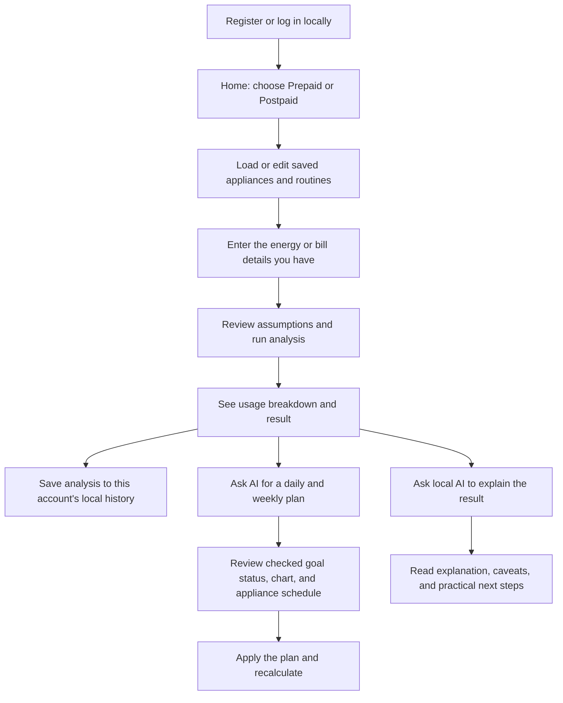
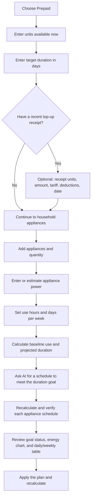
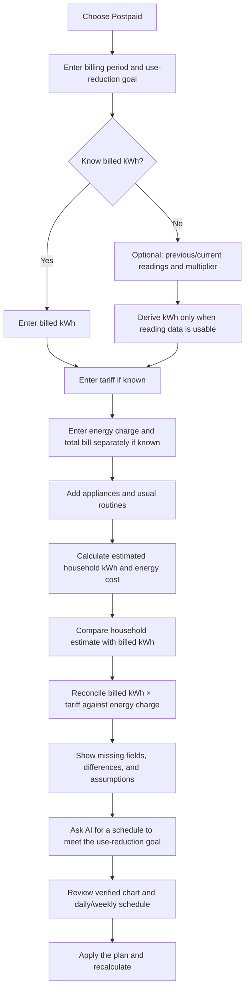
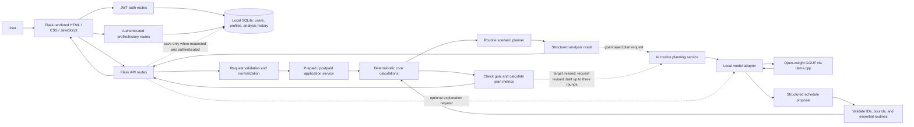

# WattWise System Design

**Status:** Proposed design for the MVP  
**Stack:** Python, Flask, HTML, CSS, JavaScript, local open-weight GGUF model  
**Product rule:** Use the local model to propose goal-based routine JSON and explain it; validate every schedule and calculate all energy and cost figures with Python.

## 1. Product understanding

WattWise helps Nigerian households understand household electricity use and plan practical routines around it.

- **Prepaid:** Customers pay before consuming electricity. A top-up credits a quantity of energy to their meter; the available credit is consumed as appliances run. WattWise estimates how long the available kWh will last and proposes routines that fit a target duration.
- **Postpaid:** Customers consume electricity during a billing period and are charged afterward for measured or, in some cases, estimated consumption. WattWise estimates household consumption from appliances and routines, compares it with billed kWh when available, and checks bill arithmetic when the necessary charge and tariff fields are supplied.
- **Both:** Users describe appliances and their routines. The local model proposes daily and weekly schedules for the user’s goal. WattWise calculates each proposed routine, protects user-marked essential appliance schedules, and reports whether the goal is feasible.

Prepaid and postpaid are different payment timings. Both involve electricity consumption measured in kWh and a price/tariff. NERC defines a prepaid meter as requiring payment in advance and credit mode as billing some or all consumption retrospectively. NERC also says the tariff is shown on prepaid vending receipts and electricity bills. See [NERC Metering Code (March 2026)](https://nerc.gov.ng/wp-content/uploads/2026/04/Metering-Code_3rd-Edition.pdf) and [NERC tariff FAQ](https://nerc.gov.ng/faq/electricity-tariffs/).

## 2. Product boundaries and trust rules

### In the MVP

- Two complete, browser-based flows: prepaid planning and postpaid analysis.
- Manual entry of meter, receipt and bill information.
- Appliance inventory with user-entered or clearly labelled estimated ratings.
- Routine entry with hours per use day, uses per week, and an optional preferred time of day.
- Deterministic energy and charge calculations.
- Goal-based routines proposed as JSON by the local open-weight model and verified with calculated consumption.
- Local model explanations based on structured, calculated results.
- Local email/password accounts with hashed passwords and JWT sessions.
- Local SQLite storage for user-owned appliance/routine profiles and analysis history.
- Local run instructions, sample data, and model/licence disclosure.

### Out of scope for the MVP

- OCR or photo upload of bills and receipts.
- Automatic IBEDC or other DisCo account access.
- Token purchasing, payments, or meter control.
- Cloud storage or a remotely hosted production database.
- OAuth/social login, email verification, password reset email, and multi-role administration.
- A claim that an appliance estimate proves a DisCo overcharged someone.

### Trust rules

1. Missing information is not zero.
2. User-entered, measured, catalog-estimated, and calculated values are labelled distinctly.
3. A prepaid top-up's **units credited** are distinct from the meter's **units currently available**.
4. A postpaid **total amount due** is distinct from the **energy charge**.
5. The model may propose appliance schedules as JSON but cannot supply authoritative energy or charge figures, claim that a bill is fraudulent, or change a user-marked essential appliance schedule.
6. WattWise recalculates every AI-generated routine and checks it against the user's goal before display. If essentials make the goal impossible, WattWise shows the closest safe schedule and says the target was not met.
7. Passwords are never stored in plaintext; account records and saved analyses are scoped to the authenticated local user.

## 3. User experience and flows

The UI should gather a few key values at a time. Details that are not needed for a first estimate stay optional or behind “Add bill details” / “I know the appliance rating” controls.

### 3.1 Shared journey



### 3.2 Prepaid journey

The form calls this a **prepaid top-up receipt** where it asks for a purchase record, and **units currently available** where it asks for meter credit. Do not call a top-up receipt a monthly postpaid bill.



**Core prepaid inputs:** available kWh, target days, appliances, routines.  
**Optional receipt context:** amount paid, units credited, tariff/band, VAT or other deductions if printed, and transaction date/reference. The meter number and token are not needed for energy planning; do not request or store a token.

The top-up receipt's units can prefill “units available now” only after the user confirms those units are still available. If the user enters only a naira amount and no units, show that a reliable kWh plan needs the credited units or enough receipt breakdown to estimate them.

### 3.3 Postpaid journey

IBEDC's published bill-detail schedule includes customer/account and meter identifiers, bill period, tariff, previous and present readings and dates, whether readings are actual or estimated, kWh used, itemised charges, arrears/credits, and total due. The MVP asks for the small set needed for an estimate first; users can expand the form for extra bill details. See [IBEDC Customer Protection Regulations, Schedule 2](https://ibedc.com/uploads/customer/Customer_Protection_Regulations_2023.pdf).



**Required for a household-use estimate:** bill period and appliance/routine inputs.  
**Optional for bill comparisons:** billed kWh or usable readings; tariff; energy charge; total bill; itemised extra charges; actual/estimated reading indicator. A user can still get a household estimate if some bill fields are missing.

### 3.4 Appliance and routine entry

Use an “Add appliance” picker with common categories (lighting, cooling, refrigeration, cooking, entertainment, pumping, laundry, other). Each appliance card asks for:

1. Appliance name/type and quantity.
2. Power input: exact watts from the label, known kWh/day, or a catalogue estimate clearly marked as an estimate.
3. Routine: hours per use day and uses per week. An optional time-of-day preference makes suggested routines easier to follow but does not change kWh arithmetic.
4. Whether it is essential to this household. The user decides; the app should not assume.

For cycling appliances such as fridges, offer measured kWh/day if known. Otherwise mark the power-times-hours result as a rough estimate and expose any adjustment factor. Do not silently assume a fridge runs at full rated watts for every hour it is connected.

## 4. Architecture and request flow



The prepaid and postpaid analysis endpoints calculate numerical results without model inference. Goal-based AI planning is a separate request: Qwen proposes a schedule, the core engine checks it, and missed targets receive up to three revision attempts. If the model is missing or fails, bill/meter analysis remains available and the planner shows a model-unavailable state.

## 5. Repository layout and module responsibilities

```text
wattwise/
├── README.md
├── PROJECT_SPEC.md
├── SYSTEM_DESIGN.md
├── requirements.txt
├── .env.example
├── .gitignore
├── app.py
├── api/
│   ├── __init__.py
│   ├── health.py
│   ├── consumption.py
│   ├── prepaid.py
│   ├── postpaid.py
│   └── recommendations.py
├── core/
│   ├── __init__.py
│   ├── schemas.py
│   ├── validation.py
│   ├── consumption.py
│   ├── tariffs.py
│   ├── prepaid_planner.py
│   ├── postpaid_analysis.py
│   └── scenarios.py
├── services/
│   ├── __init__.py
│   ├── prepaid_service.py
│   ├── postpaid_service.py
│   └── recommendation_service.py
├── ai/
│   ├── __init__.py
│   ├── adapter.py
│   ├── model_config.py
│   ├── prompts.py
│   └── output_parser.py
├── templates/
│   ├── base.html
│   ├── index.html
│   ├── prepaid.html
│   ├── postpaid.html
│   └── results.html
├── static/
│   ├── css/styles.css
│   └── js/{app.js,appliances.js,prepaid.js,postpaid.js,results.js}
├── data/
│   ├── appliance_catalog.json
│   └── sample_household.json
├── scripts/
│   └── download_model.py
├── docs/
│   └── API.md
└── tests/
    ├── test_consumption.py
    ├── test_prepaid.py
    ├── test_postpaid.py
    ├── test_scenarios.py
    ├── test_api.py
    └── test_ai_adapter.py
```

| Module | Responsibility | Must not do |
|---|---|---|
| `app.py` | Create Flask app, load config, register blueprints, set request-size limits and error handlers. | Contain calculation formulas or prompt text. |
| `api/health.py` | Report app, calculation engine, and model readiness without exposing local paths/secrets. | Load a model for every health request. |
| `api/consumption.py` | Expose model-independent household estimate endpoint. | Call the language model. |
| `api/prepaid.py` | Validate prepaid request, call service, return estimate and candidate routines. | Interpret a top-up amount as units without enough receipt data. |
| `api/postpaid.py` | Validate bill details, call service, return comparisons and caveats. | Declare fraud or compare total bill directly to energy-only cost. |
| `api/recommendations.py` | Accept a mode plus original analysis inputs and selected scenario; return a model explanation. | Trust client-submitted numeric results as authoritative. |
| `core/schemas.py` | Shared request/result shapes and serialization conventions. | Depend on Flask, HTML, or model runtime. |
| `core/validation.py` | Validate ranges, units, finite numbers, required fields, array sizes. | Silently replace missing values with zero. |
| `core/consumption.py` | Appliance and household energy arithmetic, breakdowns, assumptions. | Import AI or Flask. |
| `core/tariffs.py` | Single-rate MVP charge calculations and explicit handling of unknown rates. | Invent a current tariff or band. |
| `core/prepaid_planner.py` | Daily budget, projected duration, target feasibility, units remaining/shortfall. | Assume the top-up receipt is the current balance without confirmation. |
| `core/postpaid_analysis.py` | Derive billed kWh from valid readings when possible; compare estimated/billed kWh and charge arithmetic. | Treat household estimates as meter readings. |
| `core/scenarios.py` | Create and rank bounded, safe routine alternatives; calculate every alternative. | Change essential appliances or produce uncalculated savings. |
| `services/prepaid_service.py` | Orchestrate validate → baseline calculation → scenario generation → result. | Reimplement formulas. |
| `services/postpaid_service.py` | Orchestrate validate → consumption estimate → bill comparisons → result. | Reimplement formulas. |
| `services/recommendation_service.py` | Recompute supplied case, select approved scenario facts, call adapter, validate response. | Let model values overwrite computed fields. |
| `ai/adapter.py` | Call the standalone local `llama.cpp` OpenAI-compatible server over localhost; bound time/tokens and normalize the response. | Make external model API calls or calculate energy. |
| `ai/prompts.py` | Explain the structured facts, assumptions, selected routines, and allowed claims. | Include private identifiers or ask model to calculate. |
| `ai/output_parser.py` | Parse structured output, validate fields and scenario IDs, fall back safely. | Render untrusted HTML. |
| `data/appliance_catalog.json` | Optional user-confirmable power estimates, source, date, and confidence. | Present catalogue values as measured facts. |
| `static/js/*` | Progressive form interaction, API requests, loading/error states, render server results. | Reimplement authoritative energy calculations. |

## 6. Data structures

All numeric values sent by the browser use JSON numbers. Internal code uses decimal-safe money rounding at the presentation boundary; calculations retain sufficient precision until display. Analysis requests do not require a customer name, address, meter number, or token. Account email is stored separately from electricity analysis inputs.

### 6.1 Appliance and routine

```json
{
  "id": "app-1",
  "type": "fan",
  "label": "Bedroom fan",
  "category": "cooling",
  "quantity": 1,
  "essential": false,
  "energy_input": {
    "method": "power_and_schedule",
    "power_watts": 75,
    "source": "user_entered",
    "usage_factor": 1.0
  },
  "routine": {
    "hours_per_use_day": 8,
    "uses_per_week": 7,
    "preferred_time": "night"
  }
}
```

Alternative measured-energy input:

```json
{
  "method": "known_daily_energy",
  "kwh_per_use_day": 1.2,
  "source": "appliance_label"
}
```

Rules:

- Exactly one `energy_input.method` is active.
- `quantity` is a positive integer; power and energy values are finite and non-negative.
- `hours_per_use_day` is 0–24; `uses_per_week` is 0–7.
- `usage_factor` defaults to 1.0 and is visible when it differs from 1.0.
- `source` is `user_entered`, `catalog_estimate`, `appliance_label`, or `measured`.
- The period calculation estimates active days as `period_days × uses_per_week / 7`; show that as an average if the user has not entered exact dates.

### 6.2 Appliance catalogue entry

```json
{
  "type": "fan",
  "display_name": "Fan",
  "category": "cooling",
  "suggested_power_watts": 75,
  "source_name": "Source title",
  "source_url": "https://example.org/source",
  "updated_on": "YYYY-MM-DD",
  "is_illustrative": true
}
```

Catalogue power is a starting estimate, not a claim about the user's actual appliance. The UI lets the user edit it and labels it as an estimate.

### 6.3 Tariff input

```json
{
  "rate_ngn_per_kwh": 100.0,
  "disco": "IBEDC",
  "band": "B",
  "effective_date": "YYYY-MM-DD",
  "source": "user_bill_or_receipt"
}
```

The MVP calculates with one user-supplied rate. `disco`, `band`, and date provide context only; the app must not select a rate from a stale preset. Tiered or time-of-use tariffs are out of scope until modeled explicitly.

### 6.4 Prepaid request

```json
{
  "target_days": 14,
  "available_units_kwh": 60.0,
  "topup_receipt": {
    "amount_paid_ngn": 10000,
    "units_credited_kwh": 60.0,
    "rate_ngn_per_kwh": 100.0,
    "vat_ngn": null,
    "debt_deduction_ngn": null,
    "other_fee_ngn": null,
    "transaction_date": null
  },
  "appliances": []
}
```

`available_units_kwh` is required for planning. `topup_receipt` is optional and describes a purchase, not necessarily the current meter balance. If both receipt units and available units are supplied, keep them as two separate facts.

### 6.5 Postpaid request

```json
{
  "billing_period": {
    "days": 30,
    "start_date": null,
    "end_date": null
  },
  "billed_consumption": {
    "units_kwh": 100.0,
    "previous_reading_kwh": null,
    "present_reading_kwh": null,
    "multiplier": 1.0,
    "reading_type": "actual"
  },
  "tariff": {
    "rate_ngn_per_kwh": 100.0,
    "disco": "IBEDC",
    "band": "B",
    "effective_date": null,
    "source": "user_bill"
  },
  "bill": {
    "total_amount_ngn": 12500,
    "energy_charge_ngn": 10000,
    "other_charges_ngn": 2500,
    "arrears_or_credit_ngn": null
  },
  "appliances": []
}
```

`billing_period.days` and appliances/routines are required for the household estimate. Billed units may be entered directly or derived from usable readings: `(present − previous) × multiplier`. If readings are marked estimated, preserve that label. Bill amount, tariff, and charge components are optional; only perform comparisons supported by supplied data.

### 6.6 Standard analysis result

```json
{
  "mode": "prepaid",
  "period_days": 14,
  "estimated_consumption_kwh": 58.4,
  "estimated_daily_consumption_kwh": 4.1714,
  "energy_charge_estimate_ngn": null,
  "appliance_breakdown": [],
  "comparisons": [],
  "routine_options": [],
  "assumptions": [],
  "warnings": [],
  "input_summary": {}
}
```

Each breakdown row contains appliance id/name, quantity, per-item kWh, total kWh, input source, routine, and any adjustment factor. Each comparison records its `kind`, `observed`, `estimated`, `difference`, and units. Keep money and energy comparisons separate.

### 6.7 Routine option

```json
{
  "id": "routine-1",
  "label": "Meet your 14-day target",
  "changes": [
    {
      "appliance_id": "app-1",
      "hours_per_use_day": 5,
      "uses_per_week": 7,
      "reason_code": "reduce_discretionary_hours"
    }
  ],
  "estimated_daily_kwh": 3.8,
  "estimated_period_kwh": 53.2,
  "projected_duration_days": 15.8,
  "units_remaining_at_target_kwh": 6.8,
  "target_met": true,
  "changed_assumptions": []
}
```

Scenario values are recalculated in Python. Rank feasible options by smallest disruption to user routines, protecting user-marked essentials, then lower estimated energy. Provide a baseline and a small number of useful alternatives; do not overwhelm the results page.

## 7. Calculation and recommendation rules

### 7.1 Appliance energy

For power-and-schedule input:

`kWh = quantity × power_watts × hours_per_use_day × (uses_per_week / 7) × period_days × usage_factor / 1000`

For known daily energy:

`kWh = quantity × kwh_per_use_day × (uses_per_week / 7) × period_days`

The routine is necessary to estimate consumption. The same routine fields can be varied to generate and evaluate alternatives.

### 7.2 Prepaid planning

- Daily budget: `available_units_kwh / target_days`.
- Estimated duration: `available_units_kwh / estimated_daily_consumption_kwh`.
- Target use: `estimated_daily_consumption_kwh × target_days`.
- Remaining units / shortfall: `available_units_kwh − target_use`.
- If estimated daily use is zero, show duration as “no estimated use” rather than divide by zero.
- Target status is based on the estimate and displayed with uncertainty/assumptions.

### 7.3 Postpaid analysis

- If readings are usable: `billed_kwh = (present_reading − previous_reading) × multiplier`.
- Estimated energy charge: `estimated_household_kwh × supplied_rate`.
- Expected charge for billed energy: `billed_kwh × supplied_rate`.
- Compare billed kWh to household-estimated kWh separately from comparing energy charge to expected charge.
- Do not compare total amount due to energy-only cost unless itemised non-energy charges and arrears/credits are accounted for.
- An appliance estimate can flag a gap to investigate; it cannot prove the meter or DisCo calculation is wrong.

### 7.4 Routine generation

1. Calculate the baseline routine.
2. Keep essential appliances unchanged by default.
3. Ask Qwen for a structured schedule bounded by the user's routines and flexibility choices.
4. Validate appliance IDs, value ranges, essential status, and the rule against increasing use.
5. Recalculate with core formulas. If the target is missed, send the measured shortfall back for up to three revised model drafts.
6. Apply a disclosed calculator adjustment for a final bounded correction, or report the closest safe schedule when essentials make the goal infeasible.
7. Return the full daily/weekly schedule, baseline and planned energy values, goal status, and generated notes for UI rendering.

The model proposes the schedule and practical notes. It never supplies authoritative kWh or charge values; the API calculates those from the validated routine.

## 8. API schemas and routes

All endpoints use JSON. Common envelope:

```json
{"success": true, "data": {}, "warnings": []}
```

```json
{"success": false, "error": {"code": "VALIDATION_ERROR", "message": "Check the highlighted fields.", "details": []}}
```

### `GET /api/health`

Returns app status, calculation-engine readiness, and model state (`ready`, `not_loaded`, `loading`, `error`). Never expose paths, secrets, or stack traces.

### `POST /api/consumption/estimate`

Input: `{ "period_days": 30, "appliances": [...] }`.  
Output: consumption breakdown and assumptions only. No model call.

### `POST /api/prepaid/analyze`

Input: Prepaid request in §6.4.  
Output: baseline, daily budget, estimated duration, target status, remaining/shortfall, and calculated routine options.

### `POST /api/postpaid/analyze`

Input: Postpaid request in §6.5.  
Output: household estimate, billed units and source (entered or reading-derived), charge arithmetic where possible, comparisons, missing fields, and warnings.

### `POST /api/recommendations/plan`

Input: `{ "mode": "prepaid"|"postpaid", "case": {...} }`. Prepaid case uses available units and target days; postpaid case includes `target_reduction_percent` (5–80). Output contains the validated AI schedule, baseline/plan comparisons, charge estimates where supported, goal status, iterations, and verification details. A plan endpoint requires the configured local model; ordinary analysis endpoints do not.

### `POST /api/recommendations/explain`

Input:

```json
{
  "mode": "prepaid",
  "case": {"target_days": 14, "available_units_kwh": 60, "appliances": []},
  "selected_routine_id": "routine-1"
}
```

The service revalidates and recalculates `case` before building the model context. Output is validated structured explanation and approved routine IDs. If the model is unavailable, return a clear model error while the preceding analysis remains usable.

### Validation and status codes

- `200`: analysis succeeded.
- `400`: malformed JSON.
- `404`: unknown path.
- `413`: request exceeds configured size.
- `422`: valid JSON with invalid or missing fields.
- `503`: explanation requested but model unavailable.
- `502`: model returned a routine plan that failed validation.
- `504`: model call timed out.
- `500`: unexpected internal failure, with a generic user-safe message.

## 9. AI adapter contract

```python
class ExplanationAdapter:
    def explain(self, structured_case: dict) -> dict:
        """Return validated explanation fields; never calculate authoritative values."""
```

Model context includes mode, user goal, calculated baseline, input sources, assumptions, warnings, and precomputed routine options. It excludes token strings, meter numbers, names, addresses, and arbitrary filesystem data.

Expected model JSON:

```json
{
  "summary": "Your current routine is estimated to use more than your daily budget.",
  "key_points": ["..."],
  "recommended_routine_ids": ["routine-1"],
  "cautions": ["Appliance ratings and hours are estimates."],
  "next_steps": ["Check the wattage label on your AC if available."]
}
```

Validate required keys, text lengths, and every routine ID against the server's candidate list. Escape output in HTML. On malformed output, timeout, or load failure, retain calculations and show a fixed fallback explanation from trusted Python templates.

## 10. Module-level data flow

```mermaid
sequenceDiagram
    actor User
    participant Browser
    participant Route as Flask route
    participant Validator as core.validation
    participant Service as application service
    participant Engine as core calculations
    participant Planner as core.scenarios
    participant AI as recommendation service / local model

    User->>Browser: Enter bill/units, appliances, routine
    Browser->>Route: POST analysis JSON
    Route->>Validator: Validate and normalize
    Validator-->>Route: Typed, bounded input
    Route->>Service: Analyze case
    Service->>Engine: Compute appliance kWh and comparisons
    Engine-->>Service: Baseline structured result
    Service->>Planner: Generate safe routine candidates
    Planner->>Engine: Recalculate each candidate
    Engine-->>Planner: Candidate numerical outcomes
    Planner-->>Service: Ranked routine options
    Service-->>Route: Analysis result
    Route-->>Browser: JSON analysis
    Browser-->>User: Results and editable routine options
    User->>Browser: Ask for explanation
    Browser->>Route: POST explain with original inputs + selected option id
    Route->>Validator: Validate again
    Route->>Service: Recompute; prepare trusted context
    Service->>AI: Explain calculated facts and approved scenario
    AI-->>Service: Structured response
    Service-->>Route: Validated explanation
    Route-->>Browser: Explanation (or model unavailable)
    Browser-->>User: Explanation beside calculations
```

## 11. Error handling, privacy, and operation

- Local accounts are required for the complete platform. Use email/password registration, a password hash, signed short-lived JWT access tokens, and a local SQLite database. Do not add a cloud service requirement.
- Store one appliance/routine profile and analysis history per account. Save analysis input/result snapshots only after authentication and tell users these records remain on the machine running WattWise.
- Store SQLite and the JWT signing key under ignored `instance/`; never commit them. Provide local backup and reset instructions. Enable SQLite foreign keys and use parameterized queries.
- The browser uses HttpOnly, SameSite cookies for JWTs; API clients may use an Authorization Bearer token. Reject invalid and expired tokens. Never log passwords, tokens, or bill request bodies.
- Do not ask for prepaid token codes. Meter/account identifiers are unnecessary for calculations.
- Validate finite values, appliance count, request size, quantities, hours and tariff ranges before running work.
- Do not log request bodies containing bill details.
- Escape model output and treat it as untrusted text.
- Keep calculations available when model loading/inference fails.
- Model weights and local `.env` files are excluded from Git. Setup docs state whether the first model download needs internet.
- The linked starter is a guide, not a required UI/framework: its README calls itself a starter template and uses Gradio, while listing the project submission/demo requirements. WattWise can use Flask and HTML and still document its model, role, limits, dependencies, licences, and local run steps. See [OPEN//BUILD 2026 starter README](https://github.com/victorjayeoba/ai-app-starter).

## 12. Work split and integration order

### Developer A: Flask, frontend, model adapter

- `app.py`, `api/`, `services/`, `ai/`, templates, static assets, README, run instructions.
- Implement form flow, JSON contracts, loading/error states, model explanation endpoint.

### Developer B: energy engine and scenario planner

- `core/consumption.py`, `core/tariffs.py`, `core/prepaid_planner.py`, `core/postpaid_analysis.py`, `core/scenarios.py`, calculation fixtures.
- Define the common appliance and result contracts with Developer A before dependent implementation.

### Shared sequence

1. Agree on §6 request/result shapes.
2. Build one prepaid and one postpaid request fixture with hand-checked expected numbers.
3. Implement calculation-only endpoints and UI journeys.
4. Add routine generation using deterministic scenarios.
5. Add local model explanation as an optional layer.
6. Add local account registration/login and SQLite persistence without coupling the calculation core to authentication.
7. Document selected model, licence, RAM needs, local data handling, limits, and verified setup.
8. Verify both workflows on the actual demo machine and prepare a reproducible demo.

## 13. Decisions still to confirm before coding

1. Qwen3-0.6B GGUF Q8_0 is the current selected model and has passed a manual CLI smoke test. Re-evaluate only if response quality or speed is inadequate on the demo machine.
2. Which appliance catalog source and starter wattage values are acceptable; every preset must be clearly labelled and cited.
3. Whether the MVP targets IBEDC examples specifically or accepts any DisCo's user-entered tariff.
4. Whether the initial UI asks for preferred time-of-day or keeps routine timing to hours and days per week.
5. The range of common appliance types and which are marked essential by default (recommended: none; ask the user).

